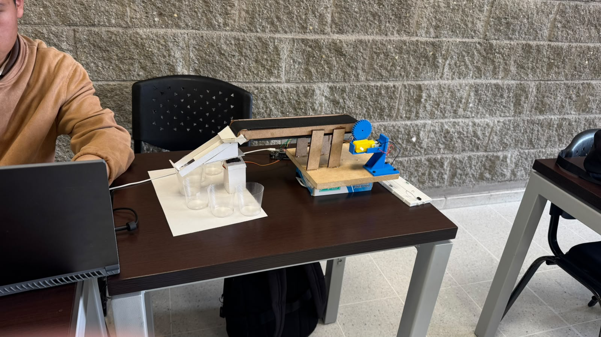
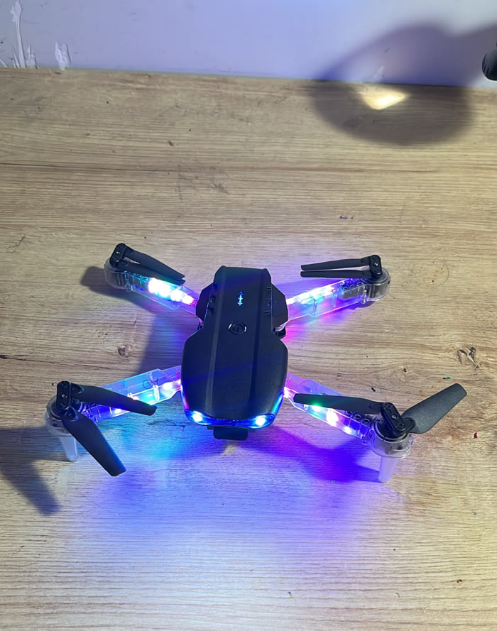

# Clasificador de monedas con YOLO11 + ESP32

Proyecto de mecatrónica (UMNG): un sistema que **reconoce monedas con visión por computador** y las **separa automáticamente en vasos** usando una banda transportadora y una rampa giratoria controladas por un ESP32.

Al final del repositorio también se documenta un segundo intento: **convertir un dron de juguete para controlarlo con un ESP32**, y por qué no se pudo cambiar su placa madre.




Videos de la prueba: [`media/demo_clasificacion_1.mp4`](media/demo_clasificacion_1.mp4) · [`media/demo_clasificacion_2.mp4`](media/demo_clasificacion_2.mp4)

---

## Contenido

1. [Cómo funciona el sistema](#1-cómo-funciona-el-sistema)
2. [Dataset y etiquetado en Roboflow](#2-dataset-y-etiquetado-en-roboflow)
3. [Entrenamiento en Google Colab](#3-entrenamiento-en-google-colab)
4. [Detector en el PC (`detector.py`)](#4-detector-en-el-pc-detectorpy)
5. [Comunicación PC → ESP32](#5-comunicación-pc--esp32)
6. [Parte mecánica: banda transportadora y rampa clasificadora](#6-parte-mecánica-banda-transportadora-y-rampa-clasificadora)
7. [El dron: por qué no se pudo cambiar la placa por un ESP32](#7-el-dron-por-qué-no-se-pudo-cambiar-la-placa-por-un-esp32)
8. [Estructura del repositorio](#8-estructura-del-repositorio)

---

## 1. Cómo funciona el sistema

El trabajo se divide en dos partes. El PC se encarga de "ver" y el ESP32 de "mover":

```
 Cámara ──► PC (detector.py + best.pt) ──► clase de la moneda ──► ESP32
                                                                    │
                                     ┌──────────────────────────────┴──────────────┐
                                     ▼                                             ▼
                        Motorreductor (banda)                         Servo (rampa giratoria)
                        lleva la moneda hasta el final                apunta la rampa al vaso
                                                                      de esa denominación
```

1. La moneda se pone sobre la banda y la cámara la captura.
2. En el PC, `detector.py` corre el modelo YOLO entrenado (`best.pt`) sobre cada cuadro de video y obtiene la **clase** (la denominación) y la **confianza** de la detección.
3. El PC le envía la clase al ESP32.
4. El ESP32 gira el **servo** para orientar la rampa hacia el vaso de esa moneda y activa el **motorreductor** para que la banda la lleve hasta el final.
5. La moneda cae de la banda a la rampa y se desliza por gravedad hasta su vaso.

Se decidió correr YOLO en el PC y no en el ESP32 porque el microcontrolador no tiene la memoria ni la capacidad de cómputo para ejecutar una red de detección a una velocidad útil. El ESP32 solo recibe una orden sencilla y mueve los actuadores.

---

## 2. Dataset y etiquetado en Roboflow

[Roboflow](https://roboflow.com) se usó para armar el dataset, etiquetarlo y exportarlo en el formato que pide YOLO.

**Pasos que se siguieron:**

1. **Crear el proyecto** de tipo *Object Detection* en Roboflow.
2. **Subir las fotos de las monedas.** Lo ideal es tomarlas con la misma cámara y sobre la misma banda donde va a trabajar el detector, con:
   - las dos caras de cada moneda,
   - diferentes posiciones y rotaciones,
   - cambios de luz (luz del salón, sombra, reflejos),
   - varias monedas en la misma imagen.
3. **Etiquetar (Annotate):** se dibuja una caja (*bounding box*) alrededor de cada moneda y se le asigna su clase. Cada denominación es una clase distinta, y cada clase corresponde a un vaso del clasificador.
4. **Dividir el dataset** en *train / valid / test* (Roboflow lo sugiere, típicamente ~70 / 20 / 10 %).
5. **Preprocesamiento y aumentos (Generate):**
   - *Preprocessing:* auto-orient y resize (por ejemplo a 640×640, el tamaño de entrada de YOLO).
   - *Augmentations:* rotación, flip, brillo/exposición y algo de desenfoque. Esto multiplica las imágenes de entrenamiento y hace al modelo más robusto ante los cambios de luz del salón.
6. **Exportar la versión** en formato **YOLOv11** (en Roboflow aparece como *YOLOv11 / YOLO11 PyTorch TXT*). Roboflow genera un fragmento de código con la API key, el workspace, el proyecto y la versión. Con ese fragmento se descarga el dataset directamente en Colab.

El formato YOLO guarda una imagen `.jpg` y un `.txt` por imagen, con una línea por objeto:

```
<id_clase> <x_centro> <y_centro> <ancho> <alto>     # valores normalizados entre 0 y 1
```

y un archivo `data.yaml` que le dice a YOLO dónde están las carpetas y cuáles son los nombres de las clases.

---

## 3. Entrenamiento en Google Colab

El entrenamiento se hizo en Google Colab para usar la **GPU gratuita** (entrenar en CPU tarda mucho más). El cuaderno de referencia está en [`entrenamiento/entrenamiento_colab.py`](entrenamiento/entrenamiento_colab.py), con una celda por bloque.

**1. Activar la GPU:** `Entorno de ejecución → Cambiar tipo de entorno de ejecución → GPU (T4)`.

**2. Instalar librerías:**

```python
!pip install ultralytics roboflow
```

**3. Descargar el dataset desde Roboflow** (este código lo genera Roboflow al exportar):

```python
from roboflow import Roboflow
rf = Roboflow(api_key="TU_API_KEY")
project = rf.workspace("TU_WORKSPACE").project("TU_PROYECTO")
version = project.version(1)
dataset = version.download("yolov11")
```

**4. Entrenar** partiendo de un modelo preentrenado (*transfer learning*). El modelo ya sabe detectar formas y bordes, y solo se le enseña a diferenciar las monedas:

```python
from ultralytics import YOLO

model = YOLO("yolo11n.pt")          # versión nano: liviana y rápida para correr en un portátil
model.train(
    data=f"{dataset.location}/data.yaml",
    epochs=100,
    imgsz=640,
    batch=16,
)
```

**5. Revisar los resultados.** Ultralytics guarda todo en `runs/detect/train/`:
- `results.png`: curvas de pérdida (*loss*) y de precisión por época.
- `confusion_matrix.png`: muestra con qué otras monedas se confunde cada clase. Es muy útil porque hay monedas de tamaño y color parecidos.
- **mAP50 / mAP50-95**: métrica principal de qué tan bien detecta.

**6. Descargar el modelo entrenado:**

```python
from google.colab import files
files.download("runs/detect/train/weights/best.pt")
```

Se usa `best.pt` (los pesos de la época con mejor mAP en validación) y no `last.pt` (la última época).

---

## 4. Detector en el PC (`detector.py`)

El `best.pt` se copia al PC y se corre desde **VS Code** con `detector.py` (carpeta [`detector/`](detector/)).

Requisitos:

```bash
pip install ultralytics opencv-python pyserial
```

La lógica del detector es:

1. Abrir la cámara con OpenCV.
2. Cargar el modelo con `YOLO("best.pt")`.
3. Correr la inferencia sobre cada cuadro y dibujar las cajas con su clase y su confianza (es lo que se ve en la pantalla del portátil en el video).
4. Cuando la detección es confiable (por encima de un umbral de confianza y estable durante algunos cuadros, para evitar mandar órdenes por detecciones falsas), enviar la clase al ESP32.

---

## 5. Comunicación PC → ESP32

El ESP32 está conectado al portátil por cable USB, y el PC le manda la clase detectada por el **puerto serial**. El ESP32:

- lee la clase que llega,
- mueve el **servo** al ángulo del vaso que corresponde a esa moneda,
- activa el **motorreductor** para que la banda avance y la moneda caiga.

El código del ESP32 está en [`esp32/`](esp32/).

---

## 6. Parte mecánica: banda transportadora y rampa clasificadora


### 6.1 Banda transportadora

| Elemento | Descripción |
|---|---|
| Estructura | Base y soportes verticales en **MDF** cortado. Los soportes sostienen el cuerpo de la banda a una altura suficiente para que la moneda caiga sobre la rampa. |
| Banda | Cinta negra que gira entre dos rodillos, uno en cada extremo. Uno de ellos es el **rodillo motriz** y el otro es el **rodillo conducido**. |
| Motor | **Motorreductor amarillo tipo TT** (motor DC con caja reductora), montado en un **soporte impreso en 3D** (azul) atornillado a la base. |
| Transmisión | **Engranajes rectos impresos en 3D** que llevan el giro del motorreductor al eje del rodillo motriz. |

**¿Por qué motorreductor y engranajes?** La banda tiene que moverse **lento y con fuerza**. Si va rápido, la moneda sale disparada y no cae en la rampa. Si no tiene torque, la fricción de la banda contra los rodillos la frena. El motorreductor TT ya baja las RPM del motor con su caja interna, y el par de engranajes ajusta todavía más la relación:

$$
i = \frac{Z_{conducido}}{Z_{motriz}}, \qquad
\omega_{rodillo} = \frac{\omega_{motor}}{i}, \qquad
\tau_{rodillo} \approx \tau_{motor}\cdot i \cdot \eta
$$

y la velocidad lineal de la banda es:

$$
v_{banda} = \omega_{rodillo}\cdot r_{rodillo}
$$

Es decir, con un engranaje conducido más grande que el piñón del motor se gana torque y se pierde velocidad, que es justo lo que se necesitaba.

**Tensión de la banda:** la cinta tiene que quedar tensa entre los dos rodillos. Si queda floja, el rodillo motriz gira y la banda patina (no hay suficiente fricción para arrastrarla).

### 6.2 Rampa clasificadora (mecanismo para que cada moneda caiga en su vaso)

Al final de la banda hay una **rampa inclinada** (canal blanco) montada sobre un **servomotor**, que está dentro de la caja blanca. Los **vasos están acomodados en arco alrededor del servo**, uno por denominación.

Funcionamiento:

1. Con la clase que manda el PC, el ESP32 gira el servo a un **ángulo fijo** asignado a esa moneda (cada vaso tiene su ángulo).
2. La moneda llega al final de la banda y **cae sobre la parte alta de la rampa**.
3. La moneda **se desliza por gravedad** a lo largo de la rampa y sale por el extremo que apunta al vaso correcto.
4. El servo queda listo para reposicionarse con la siguiente moneda.

**Condición para que la moneda deslice:** la rampa necesita una inclinación θ mayor que el ángulo de fricción entre la moneda y el material de la rampa:

$$
m g \sin\theta > \mu_s\, m g \cos\theta \;\;\Rightarrow\;\; \tan\theta > \mu_s
$$

Con superficies como cartón o cartulina, μ queda aproximadamente entre 0,3 y 0,4, así que la rampa debe ir por encima de unos **17°–22°**. En la práctica se le da un poco más para que la moneda no se quede pegada, pero no demasiado, porque llegaría con mucha velocidad y podría rebotar fuera del vaso.

Los bordes laterales del canal evitan que la moneda se salga mientras baja, y que solo se mueva el servo (y no la banda) hace que el mecanismo sea sencillo: **un solo actuador decide el destino de todas las monedas.**

---

## 7. El dron: por qué no se pudo cambiar la placa por un ESP32

<p align="center">
  
  
</p>

El dron es un **cuadricóptero de juguete plegable**. Viene con su control remoto y una app de celular (**RC UFO**) para ver la cámara y manejarlo por WiFi. La idea original era desarmarlo y **reemplazar su placa controladora por un ESP32 clásico (DevKit)** para programarlo desde cero. Se desarmó, se marcaron los brazos (**AD, AI, BI, BD**: adelante/atrás, derecha/izquierda) y se separó la placa (segunda foto).

Al analizar la placa se concluyó que **no era viable reemplazarla**, por estas razones:

**1. La placa no es solo un "cerebro": es todo el sistema de vuelo en una pieza.** En una sola tarjeta muy pequeña lleva el microcontrolador de vuelo, el **sensor inercial (giroscopio/acelerómetro)**, el **receptor de radio** del control, los **transistores (MOSFET) que manejan los 4 motores** y el circuito de carga y protección de la batería. Quitarla obliga a reconstruir todo eso, no solo a poner un microcontrolador nuevo.

**2. El ESP32 no puede mover los motores directamente.** Los motores del dron son motores DC con escobillas de núcleo hueco (*coreless*) que piden picos de corriente altos. Un pin del ESP32 solo entrega unos pocos miliamperios, así que se necesitaría un MOSFET con su diodo por cada motor, una etapa de potencia que la placa original ya trae integrada.

**3. Hay que reescribir la estabilización.** Un cuadricóptero no vuela solo con prender motores. Necesita leer el giroscopio cientos de veces por segundo y correr un **control PID** en roll, pitch y yaw para mantenerse estable. Eso está dentro del firmware de la placa original, que es cerrado y no se puede reprogramar ni copiar. Con el ESP32 tocaba montar un IMU aparte (por ejemplo un MPU6050), escribir y sintonizar los PID desde cero y arriesgarse a varios choques mientras se ajustaban.

**4. Alimentación con una sola celda (1S, 3,7 V).** La batería del dron es una LiPo de una celda: 4,2 V cargada y ~3,7 V nominal. El regulador del DevKit (AMS1117 de 3,3 V) necesita más voltaje de entrada para regular bien, y cuando los 4 motores arrancan, el voltaje de la batería cae de golpe. Eso le produce **reinicios (brownout)** al ESP32 justo en pleno vuelo.

**5. Peso y espacio.** El ESP32 DevKit completo, más los MOSFET, el IMU y los cables, pesa y ocupa más que la placa original. En un dron tan pequeño, cada gramo extra le quita empuje disponible y tiempo de vuelo, y ni siquiera cabe dentro del cuerpo.

**Decisión final:** dejar el dron con **su placa original** (que ya vuela estable) y controlarlo **por WiFi sin soldar nada**. El ESP32 hace de **puente** conectado a la red WiFi que crea el dron, la misma que usa la app RC UFO, y desde ahí se envían los comandos. La ventaja es que se mantiene la estabilización de fábrica y se puede montar una **interfaz propia**, mejor que la de la app, con opción de **control automático**.

---

## 8. Estructura del repositorio

```
clasificador-monedas-yolo-esp32/
├── README.md
├── entrenamiento/
│   └── entrenamiento_colab.py     # celdas del cuaderno de Colab (Roboflow + YOLO11)
├── detector/                      # detector.py: detector en el PC (VS Code) + envío por serial
├── esp32/                         # código del ESP32: banda (motorreductor) y servo
├── img/                           # fotos y GIF del README
└── media/                         # videos de la prueba
```

> `best.pt` no se sube al repo si pesa mucho. Se puede dejar en *Releases* o descargar desde Colab.
