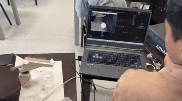
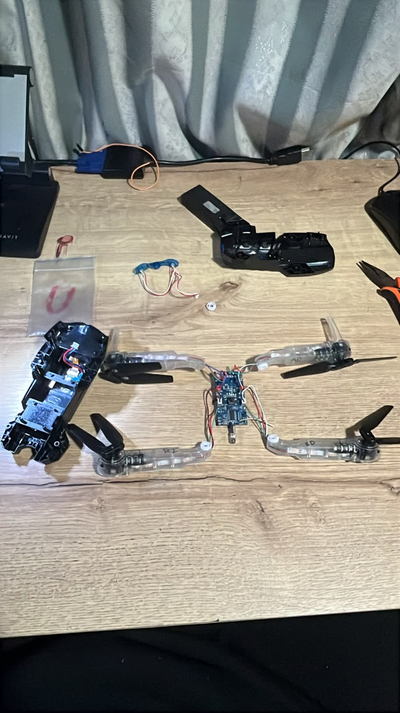

# Clasificador de monedas con YOLO11 + ESP32

Proyecto de mecatrónica (UMNG): un sistema que **reconoce monedas con visión por computador** y las **separa automáticamente en vasos** usando una banda transportadora y una rampa giratoria controladas por un ESP32.

Al final del repositorio también se documenta un segundo intento: **convertir un dron de juguete para controlarlo con un ESP32**, y por qué no se pudo cambiar su placa madre.




Videos de la prueba: [`media/demo_clasificacion_1.mp4`](media/demo_clasificacion_1.mp4) · [`media/demo_clasificacion_2.mp4`](media/demo_clasificacion_2.mp4)

---

## Contenido

1. [Cómo funciona el sistema](#1-cómo-funciona-el-sistema)
2. [Dataset y etiquetado en Roboflow](#2-dataset-y-etiquetado-en-roboflow)
3. [Entrenamiento en Google Colab](#3-entrenamiento-en-google-colab)
4. [Detector en el PC (`detector.py`)](#4-detector-en-el-pc-detectorpy)
5. [Comunicación PC → ESP32 (protocolo serial)](#5-comunicación-pc--esp32-protocolo-serial)
6. [Parte mecánica: banda transportadora y rampa clasificadora](#6-parte-mecánica-banda-transportadora-y-rampa-clasificadora)
7. [El dron: por qué no se pudo cambiar la placa por un ESP32](#7-el-dron-por-qué-no-se-pudo-cambiar-la-placa-por-un-esp32)
8. [Estructura del repositorio](#8-estructura-del-repositorio)

---

## 1. Cómo funciona el sistema

El trabajo se divide en dos partes. El PC se encarga de "ver" y el ESP32 de "mover":

```
 Cámara ──► PC: detector.py + best.pt (YOLO11) ──► comandos por USB serial (115200) ──► ESP32
                                                                                         │
                                            ┌────────────────────────────────────────────┴──────┐
                                            ▼                                                   ▼
                              Driver + motorreductor (banda)                     Servo (rampa giratoria)
                              B,<vel> / T,<vel>,<ms>                             C,<clase>  →  vaso de esa moneda
```

1. Con la tecla **`p`** la banda arranca y el sistema queda **buscando** monedas.
2. Cuando una moneda entra a la **zona de detección** (franja amarilla en el centro de la imagen), el PC **para la banda**.
3. Con la banda quieta, el PC toma **8 cuadros seguidos** y hace una **votación** para decidir qué moneda es.
4. Le manda la clase al ESP32 (`C,500`, por ejemplo). El ESP32 gira el **servo** al ángulo del vaso de esa moneda y responde `OK,C` cuando el servo ya llegó.
5. Recién ahí el PC manda **`T,30,3000`**: banda al 30 % durante 3 s. La moneda cae de la banda a la rampa y se desliza a su vaso.
6. La banda vuelve a arrancar y se repite. En pantalla se van contando las monedas clasificadas y el **total en pesos**.

YOLO corre en el PC y no en el ESP32 porque el microcontrolador no tiene la memoria ni la capacidad de cómputo para ejecutar una red de detección a una velocidad útil. El ESP32 solo recibe órdenes de texto sencillas y mueve los actuadores.

---

## 2. Dataset y etiquetado en Roboflow

[Roboflow](https://roboflow.com) se usó para armar el dataset, etiquetarlo y exportarlo en el formato que pide YOLO.

**Pasos que se siguieron:**

1. **Crear el proyecto** de tipo *Object Detection* en Roboflow.
2. **Subir las fotos de las monedas.** Lo ideal es tomarlas con la misma cámara y sobre la misma banda donde va a trabajar el detector, con:
   - las dos caras de cada moneda,
   - diferentes posiciones y rotaciones,
   - cambios de luz (luz del salón, sombra, reflejos),
   - varias monedas en la misma imagen.
3. **Etiquetar (Annotate):** se dibuja una caja (*bounding box*) alrededor de cada moneda y se le asigna su clase. Cada denominación es una clase distinta: **`50`, `100`, `200`, `500` y `1000`**. Los nombres tienen que ser exactamente esos, porque `detector.py` los usa para sumar el total en pesos y el ESP32 para escoger el vaso. Cualquier otra clase se manda al vaso de rechazo.
4. **Dividir el dataset** en *train / valid / test* (Roboflow lo sugiere, típicamente ~70 / 20 / 10 %).
5. **Preprocesamiento y aumentos (Generate):**
   - *Preprocessing:* auto-orient y resize (por ejemplo a 640×640, el tamaño de entrada de YOLO).
   - *Augmentations:* rotación, flip, brillo/exposición y algo de desenfoque. Esto multiplica las imágenes de entrenamiento y hace al modelo más robusto ante los cambios de luz del salón.
6. **Exportar la versión** en formato **YOLOv11** (en Roboflow aparece como *YOLOv11 / YOLO11 PyTorch TXT*). Roboflow genera un fragmento de código con la API key, el workspace, el proyecto y la versión. Con ese fragmento se descarga el dataset directamente en Colab.

El formato YOLO guarda una imagen `.jpg` y un `.txt` por imagen, con una línea por objeto:

```
<id_clase> <x_centro> <y_centro> <ancho> <alto>     # valores normalizados entre 0 y 1
```

y un archivo `data.yaml` que le dice a YOLO dónde están las carpetas y cuáles son los nombres de las clases.

---

## 3. Entrenamiento en Google Colab

El entrenamiento se hizo en Google Colab para usar la **GPU gratuita** (entrenar en CPU tarda mucho más). El cuaderno de referencia está en [`entrenamiento/entrenamiento_colab.py`](entrenamiento/entrenamiento_colab.py), con una celda por bloque.

**1. Activar la GPU:** `Entorno de ejecución → Cambiar tipo de entorno de ejecución → GPU (T4)`.

**2. Instalar librerías:**

```python
!pip install ultralytics roboflow
```

**3. Descargar el dataset desde Roboflow** (este código lo genera Roboflow al exportar):

```python
from roboflow import Roboflow
rf = Roboflow(api_key="TU_API_KEY")
project = rf.workspace("TU_WORKSPACE").project("TU_PROYECTO")
version = project.version(1)
dataset = version.download("yolov11")
```

**4. Entrenar** partiendo de un modelo preentrenado (*transfer learning*). El modelo ya sabe detectar formas y bordes, y solo se le enseña a diferenciar las monedas:

```python
from ultralytics import YOLO

model = YOLO("yolo11s.pt")          # versión small: más precisa que la nano y aún rápida en un portátil
model.train(
    data=f"{dataset.location}/data.yaml",
    epochs=100,
    imgsz=640,
    batch=16,
    patience=30,                     # si en 30 épocas no mejora, para antes (early stopping)
)
```

**5. Revisar los resultados.** Ultralytics guarda todo en `runs/detect/train/`:
- `results.png`: curvas de pérdida (*loss*) y de precisión por época.
- `confusion_matrix.png`: muestra con qué otras monedas se confunde cada clase. Es muy útil porque hay monedas de tamaño y color parecidos.
- **mAP50 / mAP50-95**: métrica principal de qué tan bien detecta.

**6. Descargar el modelo entrenado:**

```python
from google.colab import files
files.download("runs/detect/train/weights/best.pt")
```

Se usa `best.pt` (los pesos de la época con mejor mAP en validación) y no `last.pt` (la última época).

**Modelo usado en este proyecto:** [`detector/best.pt`](detector/best.pt)

| Dato | Valor |
|---|---|
| Arquitectura base | YOLO11s (`yolo11s.pt`) |
| Dataset | `Detector-de-monedas`, versión 2 (Roboflow) |
| Clases | `50`, `100`, `200`, `500`, `1000` |
| Épocas / imgsz / batch / patience | 100 / 640 / 16 / 30 |
| Fecha de entrenamiento | 27 de octubre de 2026 |

---

## 4. Detector en el PC (`detector.py`)

Código: [`detector/detector.py`](detector/detector.py). Corre en **VS Code** con el `best.pt` en la misma carpeta.

```bash
pip install ultralytics opencv-python pyserial
python detector.py
```

> Antes de correrlo hay que **cerrar el Monitor Serie** del Arduino IDE, porque el puerto COM solo lo puede usar un programa a la vez.

### 4.1 Parámetros de configuración

| Parámetro | Valor | Para qué sirve |
|---|---|---|
| `PUERTO` | `"COM9"` | Puerto donde está conectado el ESP32 |
| `CAMARA` | `1` | Índice de la cámara (se abre con `cv2.CAP_DSHOW`, el backend de Windows) |
| `VELOCIDAD` | `30` | Velocidad de la banda en % mientras busca monedas |
| `TIEMPO_ENTREGA` | `3000` | ms que avanza la banda para que la moneda caiga a la rampa |
| `FRAMES_VOTO` | `8` | Cuadros que se analizan para confirmar la moneda |
| `ZONA` | `(0.35, 0.0, 0.65, 1.0)` | Zona de detección: franja vertical entre el 35 % y el 65 % del ancho de la imagen |

### 4.2 Detección y filtros (`detectar`)

El modelo se corre con:

```python
model(frame, conf=0.6, iou=0.4, agnostic_nms=True, verbose=False)
```

- **`conf=0.6`**: solo se aceptan detecciones con 60 % de confianza o más.
- **`iou=0.4`**: umbral de la supresión de no-máximos (NMS) para eliminar cajas repetidas sobre el mismo objeto.
- **`agnostic_nms=True`**: el NMS se hace sin importar la clase. Así una misma moneda no puede salir detectada como dos monedas distintas al tiempo (por ejemplo `200` y `500` encima).

Después de YOLO se aplican **dos filtros geométricos** para quitar falsos positivos:

1. **Relación de aspecto** `0.75 < ancho/alto < 1.33`: una moneda es circular, entonces su caja debe ser casi cuadrada. Una caja muy alargada no es una moneda.
2. **Área relativa** `≤ 8 %` de la imagen: una moneda sobre la banda ocupa poco espacio en la imagen. Si la caja es más grande (por ejemplo, la mano), se descarta.

Las cajas descartadas se dibujan en **gris**, las monedas válidas en **verde** y, si el modelo devuelve una clase que no está en `{"50", "100", "200", "500", "1000"}`, se toma como **`rechazo`** y se dibuja en **rojo**.

### 4.3 Máquina de estados

El programa principal funciona con 4 estados:

```
            p                 moneda en la zona                 8 cuadros y ≥ 4 votos
 PAUSA ──────────► BUSCANDO ───────────────────► CONFIRMANDO ──────────────────────► ENTREGANDO
   ▲     p           ▲  banda a VELOCIDAD          banda en 0          │              C,<clase> → OK,C
   └─────────────────┤                                                 │              T,<vel>,3000
                     │◄────────────── menos de 4 votos ────────────────┘                   │
                     └◄───────────────────── pasan 3 s + 0,2 s ────────────────────────────┘
```

- **PAUSA**: banda detenida, espera la tecla `p`.
- **BUSCANDO**: banda a `VELOCIDAD`. Apenas aparece una moneda dentro de la zona, manda `B,0` (parar) y pasa a CONFIRMANDO.
- **CONFIRMANDO**: durante 8 cuadros guarda en cada cuadro la clase de la moneda con **mayor confianza** dentro de la zona. Al final:
  - si hay **al menos 4 votos** (la mitad), la clase final es **la más votada** (`Counter(votos).most_common(1)`). La votación evita que un cuadro mal clasificado mande la moneda al vaso equivocado.
  - si hay menos de 4 votos (la moneda no se vio bien), se considera falsa alarma y la banda sigue buscando.
- **ENTREGANDO**: manda `C,<clase>`, **espera el `OK,C`** (el servo ya está apuntando al vaso) y luego manda `T,<vel>,3000`. Suma la moneda al contador y al total en pesos, y cuando pasa el tiempo de entrega vuelve a BUSCANDO.

Esperar el `OK,C` antes de mover la banda es importante: si la banda avanzara antes de que el servo llegue, la moneda podría caer con la rampa todavía girando.

### 4.4 Interfaz y teclas

En la ventana se muestran el estado actual, la última moneda, la cantidad de monedas clasificadas, el **total en pesos** y el conteo por denominación.

| Tecla | Acción |
|---|---|
| `p` | Iniciar / pausar la banda |
| `+` / `-` | Subir / bajar la velocidad de 5 en 5 % (entre 20 y 100 %) |
| `q` | Salir: para la banda y deja el servo en 90° antes de cerrar |

La clase `ESP32` del script también permite **probar sin la placa conectada**: si no puede abrir el puerto, sigue funcionando y solo imprime los comandos en la consola.

---

## 5. Comunicación PC → ESP32 (protocolo serial)

El ESP32 está conectado al portátil por USB y se comunica por **serial a 115200 baudios**. Cada comando es **una línea de texto terminada en `\n`**, y el ESP32 responde a cada uno:

| Comando | Qué hace | Respuesta |
|---|---|---|
| `B,<vel>` | Banda continua a `vel` % (0 = parar) | `OK,B` |
| `T,<vel>,<ms>` | Banda a `vel` % durante `ms` milisegundos y se detiene sola | `OK,T` y al terminar `FIN,T` |
| `A,<ángulo>` | Servo a un ángulo de 0 a 180° | `OK,A` cuando el servo ya llegó |
| `C,<clase>` | Servo a la posición del vaso de esa moneda (`50`, `100`, `200`, `500`, `1000` o `rechazo`) | `OK,C` cuando el servo ya llegó |
| `E` | Prueba de vida | `E,OK` |
| (cualquier otra cosa) | — | `ERR,<línea>` |

**Arranque (handshake):** al encender, el ESP32 manda `LISTO`. `detector.py` espera esa palabra hasta 4 s. Si no llega (por ejemplo, porque el ESP32 ya estaba encendido antes de abrir el puerto), manda `E` y espera `E,OK` para confirmar que la placa sí responde.

### 5.1 Código del ESP32 (`esp32_clasificador.ino`)

Código: [`esp32_clasificador/esp32_clasificador.ino`](esp32_clasificador/esp32_clasificador.ino). Se sube desde el Arduino IDE con la placa **ESP32 Dev Module**, y no necesita librerías extra.

**Conexiones (ESP32 clásico, DevKit):**

| Pin ESP32 | Va a |
|---|---|
| GPIO 25 | ENA / PWMA del driver del motor (velocidad, PWM) |
| GPIO 26 | IN1 del driver (sentido) |
| GPIO 27 | IN2 del driver (sentido) |
| GPIO 18 | Señal del servo |
| GND | GND común del ESP32, del driver y del servo |

- El servo y el motor se alimentan con **su propia fuente**, no con el 3V3 del ESP32. Solo se unen las tierras.
- Se recomiendan **resistencias de 10 kΩ a GND** en IN1, IN2 y ENA, para que el motor no arranque solo mientras el ESP32 se está reiniciando (en ese momento los pines quedan flotando).

**PWM con el periférico LEDC del ESP32:**

| Salida | Frecuencia | Resolución | Por qué |
|---|---|---|---|
| Motor (canal 0) | 20 kHz | 10 bits (0–1023) | 20 kHz está por encima de lo que escucha el oído, así el motor no "pita" |
| Servo (canal 2) | 50 Hz | 14 bits | El servo necesita un periodo de 20 ms. Con 14 bits se logra buena resolución en el ancho de pulso |

Se usan los canales 0 y 2 porque pertenecen a **temporizadores distintos**, y las dos frecuencias no pueden compartir el mismo temporizador. El código funciona con el core de ESP32 **2.x y 3.x** (la API de `ledc` cambió entre versiones).

**Control del servo:** el ángulo se convierte a ancho de pulso entre 500 y 2400 µs, y luego a ciclo útil:

$$
t_{pulso} = 500 + (2400 - 500)\cdot\frac{\theta}{180}\;[\mu s], \qquad
duty = t_{pulso}\cdot\frac{2^{14}-1}{20000}
$$

Para saber cuándo responder `OK,A` / `OK,C`, el ESP32 estima el tiempo que tarda el servo en llegar: **150 ms + 4 ms por cada grado** que se mueve.

**Todo es sin bloqueo:** el `loop()` no usa `delay()`. Los tiempos de la banda (`T`) y las respuestas del servo se controlan con `millis()`, entonces el ESP32 sigue leyendo comandos mientras la banda avanza o el servo se mueve. Además, las líneas demasiado largas (más de 47 caracteres) se descartan completas para que no se procese un comando cortado.

---

## 6. Parte mecánica: banda transportadora y rampa clasificadora


### 6.1 Banda transportadora

| Elemento | Descripción |
|---|---|
| Estructura | Base y soportes verticales en **MDF** cortado. Los soportes sostienen el cuerpo de la banda a una altura suficiente para que la moneda caiga sobre la rampa. |
| Banda | Cinta negra que gira entre dos rodillos, uno en cada extremo. Uno de ellos es el **rodillo motriz** y el otro es el **rodillo conducido**. |
| Motor | **Motorreductor amarillo tipo TT** (motor DC con caja reductora), montado en un **soporte impreso en 3D** (azul) atornillado a la base. Se maneja con un **driver de puente H** (velocidad por PWM en ENA y sentido con IN1/IN2). |
| Transmisión | **Engranajes rectos impresos en 3D** que llevan el giro del motorreductor al eje del rodillo motriz. |

**¿Por qué motorreductor y engranajes?** La banda tiene que moverse **lento y con fuerza**. Si va rápido, la moneda sale disparada y no cae en la rampa. Si no tiene torque, la fricción de la banda contra los rodillos la frena. El motorreductor TT ya baja las RPM del motor con su caja interna, y el par de engranajes ajusta todavía más la relación:

$$
i = \frac{Z_{conducido}}{Z_{motriz}}, \qquad
\omega_{rodillo} = \frac{\omega_{motor}}{i}, \qquad
\tau_{rodillo} \approx \tau_{motor}\cdot i \cdot \eta
$$

y la velocidad lineal de la banda es:

$$
v_{banda} = \omega_{rodillo}\cdot r_{rodillo}
$$

Es decir, con un engranaje conducido más grande que el piñón del motor se gana torque y se pierde velocidad, que es justo lo que se necesitaba.

**Tensión de la banda:** la cinta tiene que quedar tensa entre los dos rodillos. Si queda floja, el rodillo motriz gira y la banda patina (no hay suficiente fricción para arrastrarla).

### 6.2 Rampa clasificadora (mecanismo para que cada moneda caiga en su vaso)

Al final de la banda hay una **rampa inclinada** (canal blanco) montada sobre un **servomotor**, que está dentro de la caja blanca. Los **vasos están acomodados en arco alrededor del servo**: uno por cada denominación y uno más para las monedas de **rechazo**.

Cada vaso tiene su ángulo de servo, que se calibró en el código del ESP32:

| Moneda | Ángulo del servo |
|---|---|
| \$50 | 12° |
| \$100 | 46° |
| \$200 | 74° |
| \$500 | 112° |
| \$1000 | 148° |
| Rechazo (o clase desconocida) | 176° |

Al encender, el servo arranca en **90°**.

Funcionamiento:

1. Con la clase que manda el PC (`C,<clase>`), el ESP32 gira el servo al ángulo de ese vaso.
2. Cuando el servo ya llegó, la banda avanza 3 s y la moneda **cae sobre la parte alta de la rampa**.
3. La moneda **se desliza por gravedad** a lo largo de la rampa y sale por el extremo que apunta al vaso correcto.

**Condición para que la moneda deslice:** la rampa necesita una inclinación θ mayor que el ángulo de fricción entre la moneda y el material de la rampa:

$$
m g \sin\theta > \mu_s\, m g \cos\theta \;\;\Rightarrow\;\; \tan\theta > \mu_s
$$

Con superficies como cartón o cartulina, μ queda aproximadamente entre 0,3 y 0,4, así que la rampa debe ir por encima de unos **17°–22°**. En la práctica se le da un poco más para que la moneda no se quede pegada, pero no demasiado, porque llegaría con mucha velocidad y podría rebotar fuera del vaso.

Los bordes laterales del canal evitan que la moneda se salga mientras baja, y que solo se mueva el servo (y no la banda) hace que el mecanismo sea sencillo: **un solo actuador decide el destino de todas las monedas.**

---

## 7. El dron: por qué no se pudo cambiar la placa por un ESP32

<p align="center">
  
  
</p>

El dron es un **cuadricóptero de juguete plegable**. Viene con su control remoto y una app de celular (**RC UFO**) para ver la cámara y manejarlo por WiFi. La idea original era desarmarlo y **reemplazar su placa controladora por un ESP32 clásico (DevKit)** para programarlo desde cero. Se desarmó, se marcaron los brazos (**AD, AI, BI, BD**: adelante/atrás, derecha/izquierda) y se separó la placa (segunda foto).

Al analizar la placa se concluyó que **no era viable reemplazarla**, por estas razones:

**1. La placa no es solo un "cerebro": es todo el sistema de vuelo en una pieza.** En una sola tarjeta muy pequeña lleva el microcontrolador de vuelo, el **sensor inercial (giroscopio/acelerómetro)**, el **receptor de radio** del control, los **transistores (MOSFET) que manejan los 4 motores** y el circuito de carga y protección de la batería. Quitarla obliga a reconstruir todo eso, no solo a poner un microcontrolador nuevo.

**2. El ESP32 no puede mover los motores directamente.** Los motores del dron son motores DC con escobillas de núcleo hueco (*coreless*) que piden picos de corriente altos. Un pin del ESP32 solo entrega unos pocos miliamperios, así que se necesitaría un MOSFET con su diodo por cada motor, una etapa de potencia que la placa original ya trae integrada.

**3. Hay que reescribir la estabilización.** Un cuadricóptero no vuela solo con prender motores. Necesita leer el giroscopio cientos de veces por segundo y correr un **control PID** en roll, pitch y yaw para mantenerse estable. Eso está dentro del firmware de la placa original, que es cerrado y no se puede reprogramar ni copiar. Con el ESP32 tocaba montar un IMU aparte (por ejemplo un MPU6050), escribir y sintonizar los PID desde cero y arriesgarse a varios choques mientras se ajustaban.

**4. Alimentación con una sola celda (1S, 3,7 V).** La batería del dron es una LiPo de una celda: 4,2 V cargada y ~3,7 V nominal. El regulador del DevKit (AMS1117 de 3,3 V) necesita más voltaje de entrada para regular bien, y cuando los 4 motores arrancan, el voltaje de la batería cae de golpe. Eso le produce **reinicios (brownout)** al ESP32 justo en pleno vuelo.

**5. Peso y espacio.** El ESP32 DevKit completo, más los MOSFET, el IMU y los cables, pesa y ocupa más que la placa original. En un dron tan pequeño, cada gramo extra le quita empuje disponible y tiempo de vuelo, y ni siquiera cabe dentro del cuerpo.

**Decisión final:** dejar el dron con **su placa original** (que ya vuela estable) y controlarlo **por WiFi sin soldar nada**. El ESP32 hace de **puente** conectado a la red WiFi que crea el dron, la misma que usa la app RC UFO, y desde ahí se envían los comandos. La ventaja es que se mantiene la estabilización de fábrica y se puede montar una **interfaz propia**, mejor que la de la app, con opción de **control automático**.

---

## 8. Estructura del repositorio

```
├── README.md
├── entrenamiento/
│   └── entrenamiento_colab.py        # celdas del cuaderno de Colab (Roboflow + YOLO11)
├── detector/
│   ├── detector.py                   # detector en el PC (VS Code) + comandos por serial
│   └── best.pt                       # modelo YOLO11s entrenado
├── esp32_clasificador/
│   └── esp32_clasificador.ino        # control de banda (driver + motorreductor) y servo
├── img/                              # fotos y GIF del README
└── media/                            # videos de la prueba
```

**Para correr el proyecto:**

1. Subir `esp32_clasificador.ino` al ESP32 (Arduino IDE → *ESP32 Dev Module*).
2. Si es necesario, calibrar los ángulos de los vasos en `POSICIONES[]`.
3. Ajustar `PUERTO` y `CAMARA` en `detector.py` (el `best.pt` ya está en la carpeta `detector/`).
4. Cerrar el Monitor Serie y, desde la carpeta `detector/`, correr `python detector.py`. Presionar **`p`** para arrancar.
